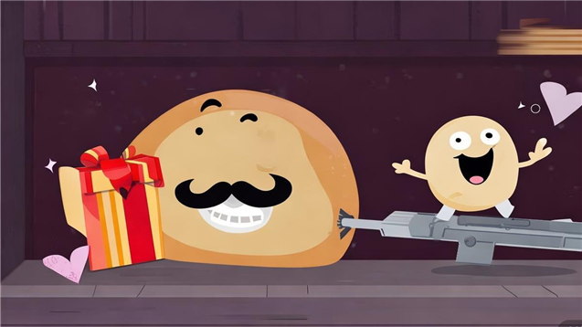
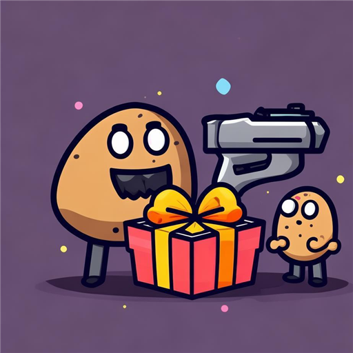

# 这是一份给我义子的礼物 (A Gift for My FosterSon)



Brotato（土豆兄弟）合作模式**道具 & 武器赠送** mod —— [ShareWithYourBro](https://steamcommunity.com/sharedfiles/filedetails/?id=3718814620) 的 1.2.0.1 / Primal Dread 复刻继任者。

> **状态**：v0.1.13 · 已实机验证（Brotato 1.2.0.1 + Godot Mod Loader 6.3，双人流向赠送/武器赠送/导航/弹窗全通过）
> 下载：见 [Releases](../../releases)，附件 `KD-AGiftforMyFosterSon-v0.1.13.zip`。



## 功能

- 合作商店中，点击自己已拥有的**道具或武器** → 弹出赠送按钮（2 人局一个「送给队友」；3/4 人局每个队友一个，标签带角色名，如「送给 小土豆 (P3)」）
- **武器可赠送**：机械化（Mechanize）状态随武器一起转移；原版合成/机械化/回收按钮照常可用
- 赠送后自己失去道具与效果、队友获得，双方面板即时刷新
- 每个目标独立检查上限：道具持有上限 / 武器栏空位，满员按钮灰显带提示
- 宠物类道具可赠送——下一波宠物跟随新主人
- 普通诅咒道具可赠送（把「负担」送给队友也是一种玩法）
- 特殊道具黑名单（芹菜茶/诱饵/孔雀/沙漏/一次性下波效果），防平衡与逻辑事故
- **对原生 UI 零侵入**：不动游戏自带按钮的焦点链（含 1.2 新版机械化工坊），可随时启停
- 11 种语言本地化（EN / 中文 / 繁中 / FR / DE / ES / IT / JA / KO / PL / PT）
- 内置兼容自检 + 诊断日志（`compat:` / `diag:` / `gift:` 行写入 `%APPDATA%\Brotato\logs\godot.log`）

## 设计要点（为什么它能扛游戏更新）

1. **防御式探测**：所有游戏 API 调用前 `has_method`/`get()` 探测，缺失降级并写日志而非崩溃
2. **零侵入焦点管理**：只在自己注入的按钮间组焦点链，对原生按钮的两处临时补丁（取消键"上"、上方按钮"下"）均保存原值、可完整还原
3. **单点挂载架构**：1.2.0.1 的 `base_shop.gdc` 字节码损坏，凡继承链经过 `BaseShop` 的脚本（base_shop/coop_shop/shop）都无法被 GML 扩展按路径加载——赠送执行逻辑全部收敛到唯一健康的 `item_popup` 扩展，商店/容器服务通过向上探测动态获取，商店脚本零接触
4. **离线编译验证**：见 `scripts/validate-offline.sh`——不装游戏，用自写 API 桩工程 + Godot 3.6 `--check-only` 校验全部脚本

## 安装

- **推荐**：Steam 创意工坊订阅 → [这是一份给我义子的礼物](https://steamcommunity.com/sharedfiles/filedetails/?id=3835948655)
- 手动：把 Release 的 zip 原样放进任意**处于订阅状态**的工坊 mod 文件夹（`<Steam>\steamapps\workshop\content\1942280\<已订阅mod的ID>\`）。注意 GML 6.3 只扫描 Steam 订阅目录内的 zip，自建文件夹不会被加载

## 仓库结构

```
mod-src/KD-AGiftforMyFosterSon/    # mod 源码(manifest + mod_main + item_popup 扩展)
stub-check/                        # 自写的 Brotato API 桩工程(离线编译验证用)
scripts/validate-offline.sh        # 一键:生成变换副本 → Godot 编译检查
art/                               # 工坊图标(512)与画廊图(637x358),AI 生成
docs/生态兼容性审计.md              # 工坊Top25热门mod全量兼容矩阵
docs/工坊描述-BBCode.txt            # 工坊页面描述(BBCode)
```

## 合规声明

- 本仓库与发行包**不含任何 Brotato 游戏代码**（扩展脚本全部自研，防御式探测不复制原方法体）
- 不含任何第三方 mod 内容；`stub-check/` 全部为自写桩
- 仓库与工坊发行包内容一致，可审计；以 [MIT](LICENSE) 协议开源

## 技术栈

GDScript (Godot 3.6) · Godot Mod Loader 6.3+ · 零依赖 · 纯脚本扩展

---

# English


**A Gift for My FosterSon** — co-op item & weapon gifting mod for Brotato 1.2.0.1 (Primal Dread), spiritual successor to [ShareWithYourBro](https://steamcommunity.com/sharedfiles/filedetails/?id=3718814620). Available on [Steam Workshop](https://steamcommunity.com/sharedfiles/filedetails/?id=3835948655).

## Features

- Gift buttons on owned item **and weapon** popups in the co-op shop (one per teammate in 3/4-player games, labeled with the character's name)
- Weapons are giftable — Mechanize state transfers with the weapon; vanilla combine/mechanize/recycle buttons keep working
- You lose the item and all its effects, the teammate gains them, both stat panels refresh instantly
- Per-teammate limit checks (item cap / weapon slots) with disabled-state tooltips
- Pet items follow their new owner next wave; regular cursed items are giftable too
- Blacklist for special-case items (celery tea / lure / peacock / hourglass / next-wave one-shots)
- Zero footprint on vanilla UI (incl. the 1.2 Mechanize shop) — safe to enable/disable anytime
- 11-language localization, built-in compatibility self-check & diagnostics

## Why it survives game updates

1. Defensive probing before every game API call — degrade & log instead of crashing
2. Non-invasive focus management — vanilla button patches are saved and fully restorable
3. Single-mount architecture: 1.2.0.1 ships a corrupted `base_shop.gdc`, so the whole `BaseShop` inheritance chain can't be extended via GML — all gifting logic lives in the one healthy `item_popup` extension, with shop services discovered upward at runtime
4. Offline compile validation via a hand-written API stub project + Godot 3.6 `--check-only` (`scripts/validate-offline.sh`)

## Install

Subscribe on [Steam Workshop](https://steamcommunity.com/sharedfiles/filedetails/?id=3835948655), or drop the Release zip into any **subscribed** workshop mod folder — GML 6.3 only scans zips inside Steam-subscribed item directories.

## Compliance

No Brotato game code in this repo or the release package (all extensions hand-written); no third-party mod content; `stub-check/` is fully self-authored stubs. The repo mirrors the workshop package and is open-sourced under the [MIT License](LICENSE).

Tech: GDScript (Godot 3.6) · Godot Mod Loader 6.3+ · zero dependencies · pure script extensions
